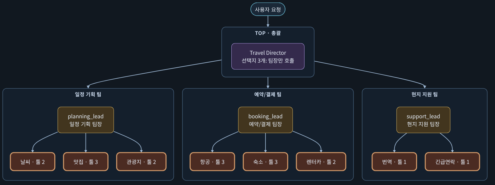
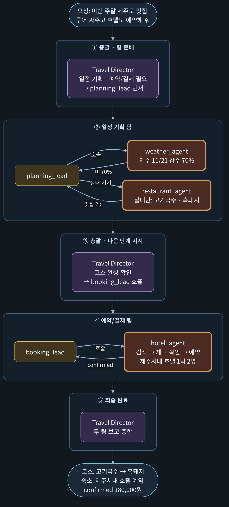
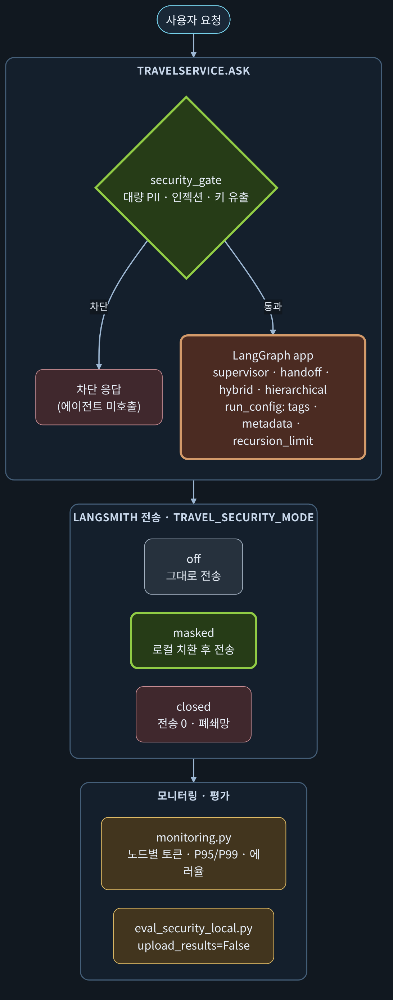

# Supervisor / Handoff 멀티 에이전트 여행 플래너 (LangGraph)

날씨 · 맛집 · 숙소예약 3개 전문 에이전트를 네 가지 구조로 구성한 설계 골격입니다.
툴은 모두 mock이며, 실행 검증 전의 설계용 코드입니다.

| 안 | 파일 | 적합한 경우 |
|---|---|---|
| A. 슈퍼바이저 | `travel_planner/supervisor_graph.py` | "일정 다 짜줘" 원샷 일정표 (예약 불가) |
| B. 핸드오프 | `travel_planner/handoff_graph.py` | 대화하며 하나씩 정하고 예약 |
| A+B 하이브리드 | `travel_planner/hybrid_graph.py` | 초안 생성 → 사용자 승인 → 예약 대화로 이양 |
| 계층형 (Hierarchical) | 브랜치 `01-hierarchical-supervisor` | 하위 에이전트 8개 이상: 총괄 → 팀장 → 실무자 |

## 구조

- **A**: `supervisor ⇄ {weather, restaurant, hotel}`. 비 오면 실내 맛집 → 맛집 동선 근처 숙소 → 종합. 숙소 에이전트는 예약 툴 없음.
- **B**: `weather ⇄ restaurant ⇄ hotel`. `transfer_to_*` 툴로 제어권을 넘기며 `MemorySaver`로 멀티턴 유지.
- **A+B**: `planner(A) → approval(interrupt) → hotel_booking`. 거절/변경 시 `planner`로 복귀. `draft_plan`을 State로 넘겨 날짜·지역을 다시 묻지 않음.

## 브랜치

| 번호 | 브랜치 | 내용 |
|---|---|---|
| 01 | `01-hierarchical-supervisor` | 계층형 코드 (`hierarchical_graph.py`, `hierarchical_tools.py`) + 흐름 시뮬레이션 `examples/simulate_hierarchical.py` |
| 02 | `02-langsmith-observability` | 01 포함 + LangSmith 연동: 보안 모드·게이트·로컬 평가·병목 모니터링 |

`main`에는 설계 문서(이 README)와 A / B / A+B 코드가 있고, 계층형 구현은 01, LangSmith 연동은 02 브랜치에 있습니다. (02는 01을 포함합니다.)

## 계층형(Hierarchical) 구조

하위 에이전트가 많아져 단일 슈퍼바이저가 감당하기 어려울 때, 중간 관리자(팀장) 슈퍼바이저를 두고 그 위에 총괄 슈퍼바이저를 배치하는 피라미드식 구조입니다.
도메인(팀) 단위로 나눠 각 관리자가 보는 선택지(프롬프트 길이)를 3~5개 이하로 제한하는 것이 핵심입니다.

### 설계 로직 flowchart



- 총괄(Travel Director)은 팀장 3명만 보고, 각 팀장은 자기 팀원만 봅니다.
- 에이전트당 툴은 3개 이하입니다: 날씨 2 / 맛집 3 / 관광지 2 / 항공 3 / 숙소 3 / 렌터카 2 / 번역 1 / 긴급연락 1.

### 작동 흐름 예시 (설계 로직에 요청을 대입한 flowchart)

요청: **"이번 주말 제주도 맛집 투어 짜주고 호텔도 예약해 줘"**



1. **총괄**: 일정 기획과 예약/결제 두 팀이 필요하다고 판단해 `planning_lead`를 먼저 호출합니다.
2. **일정 기획 팀장**: 팀원 `weather_agent`, `restaurant_agent`만 호출해 코스 초안을 만들고 총괄에게 보고합니다. (강수확률 70%이므로 실내 맛집만 선택)
3. **총괄**: 코스 완성을 확인하고 `booking_lead`에게 숙소 예약을 지시합니다.
4. **예약/결제 팀장**: `hotel_agent`가 검색 → 재고 확인 → 예약을 실행하고, 결과를 보고받습니다.
5. **최종 완료**: 총괄이 두 팀장의 보고를 합쳐 사용자에게 답변합니다.

### 실행 결과

`examples/simulate_hierarchical.py` (브랜치 `01-hierarchical-supervisor`)를 실행한 출력입니다.
LLM 없이 라우팅을 스크립트로 고정하고 mock 툴을 실제로 호출하므로, 값은 mock 데이터입니다.

```text
요청: 이번 주말 제주도 맛집 투어 짜주고 호텔도 예약해 줘

① 최상위 총괄 (travel_director)
  [LLM #1] travel_director: 일정 기획 + 예약/결제 두 팀 필요 → planning_lead 먼저 호출

② 일정 기획 팀장 (planning_lead)
  [LLM #2] planning_lead: weather_agent 호출
      · tool get_weather(city='제주', date='2026-11-21') -> {'city': '제주', 'date': '2026-11-21', 'rain_prob': 70, 'summary': '비'}
      · tool get_hourly_forecast(city='제주', date='2026-11-21') -> [{'hour': 9, 'rain_prob': 40}, {'hour': 12, 'rain_prob': 70}, {'hour': 15, 'rain_prob': 80}, {'hour': 18, 'rain_prob': 60}]
  [LLM #3] planning_lead: 강수확률 70% → 실내 위주로 restaurant_agent 호출
      · tool search_restaurants(city='제주', indoor_only=True) -> [{'id': 'r1', 'name': '제주 고기국수 맛집', 'indoor': True}, {'id': 'r2', 'name': '제주 흑돼지 구이집', 'indoor': True}]
  [LLM #4] planning_lead: 코스 초안 완성 ['제주 고기국수 맛집', '제주 흑돼지 구이집'] → 총괄에게 보고

③ 최상위 총괄
  [LLM #5] travel_director: 코스 완성 확인 → booking_lead 에게 숙소 예약 지시

④ 예약/결제 팀장 (booking_lead)
  [LLM #6] booking_lead: hotel_agent 호출
      · tool search_hotels(city='제주', near='제주시내', checkin='2026-11-21', nights=1) -> [{'id': 'h1', 'name': '제주시내 호텔', 'price_per_night': 180000, 'checkin': '2026-11-21', 'nights': 1}]
      · tool check_room(hotel_id='h1', checkin='2026-11-21', nights=1) -> {'hotel_id': 'h1', 'available': True}
      · tool book_hotel(hotel_id='h1', guests=2, checkin='2026-11-21', nights=1) -> {'status': 'confirmed', 'hotel_id': 'h1', 'guests': 2, 'checkin': '2026-11-21', 'nights': 1}
  [LLM #7] booking_lead: 예약 confirmed → 총괄에게 보고

⑤ 최종 완료 (travel_director)
  [LLM #8] travel_director: 두 팀 보고 종합 → 사용자에게 최종 답변

최종 답변:
  - 날씨: 2026-11-21 강수확률 70% → 실내 위주 코스
  - 맛집 코스: 제주 고기국수 맛집 → 제주 흑돼지 구이집
  - 숙소: 제주시내 호텔 (2026-11-21 체크인, 1박, 2명) 예약 confirmed, 180,000원

슈퍼바이저 판단용 LLM 호출 8회 (실무자 에이전트의 툴 호출용 LLM 호출은 제외)
```

### 계층형 구조 도입 시 주의할 점

- **응답 지연(Latency)과 비용 증가**: `총괄 → 팀장 → 실무자 → 팀장 → 총괄` 순으로 LLM 호출 단계가 깊어지므로 응답이 느려지고 토큰 소모가 큽니다.
- **실무 팁**: 처음부터 계층형으로 짜지 말고 단일 슈퍼바이저나 핸드오프로 시작하세요. 에이전트 개수가 7~8개를 넘어가며 정확도가 떨어질 때 팀을 나누어 계층형으로 승격시키는 것이 좋습니다.

## LangSmith 연동 (브랜치 `02-langsmith-observability`)

기존 4개 구조(supervisor / handoff / hybrid / hierarchical)는 수정하지 않고, 컴파일된 그래프를 **바깥에서 감싸는** 방식으로 연결합니다.



| 파일 | 역할 |
|---|---|
| `travel_planner/observability.py` | 보안 모드(off/masked/closed), 민감정보 마스킹(anonymizer), `run_config`(태그·메타데이터·`recursion_limit`), 입력 보안 게이트 |
| `travel_planner/service.py` | `TravelService(pattern, model).ask(...)`: 4개 구조를 같은 인터페이스로 실행 (게이트 + 트레이싱 + 스텝 타임아웃) |
| `travel_planner/monitoring.py` | 노드별 토큰·P50/P95/P99·에러율 집계와 튜닝 액션 진단. `fetch_runs`로 LangSmith 조회 |
| `examples/eval_security_local.py` | `upload_results=False` 로컬 보안 평가 (데이터셋·결과를 서버에 올리지 않음) |
| `examples/report_bottlenecks.py` | 병목 리포트 (`--demo` 또는 `--project`) |
| `travel_planner/single_graph.py` | 기준선: 도구 전부를 가진 단일 에이전트 (`TravelService("single", ...)`) |
| `travel_planner/benchmark.py` | 구조별 LLM 호출·도구 호출·시간·입력 크기 측정 (스크립트 모델 + 콜백 `Meter`) |
| `examples/benchmark_structures.py` | 5개 구조를 한 번에 비교하는 실행 스크립트 (`--live`로 실제 LLM 실측) |
| `tests/test_benchmark.py` | "단일이 가장 싸다"는 구조적 사실을 테스트로 고정 |
| `examples/playground.py` | 브라우저 플레이그라운드: 흐름·전송 내용·병목 통계를 눈으로 확인 |
| `tests/test_observability.py` | 마스킹·게이트·모니터링·전송 내용 검증 (18개) |
| `.env.example` | `LANGSMITH_*`, `TRAVEL_SECURITY_MODE` |

### 보안 모드 (`TRAVEL_SECURITY_MODE`)

| 모드 | 동작 |
|---|---|
| `off` | 마스킹 없이 트레이스 전송 (개발용) |
| `masked` (기본) | 주민번호·카드·전화·이메일·API 키·`password=` 값을 **전송 직전 로컬에서** 치환 후 전송 |
| `closed` | 트레이싱 완전 차단. 외부 LangSmith 로 전송하지 않음 (폐쇄망) |

마스킹은 `create_anonymizer`로 문자열 노드만 치환하므로 트레이스의 중첩 구조가 유지됩니다.
(`str(data)` 전체를 `{"masked_payload": ...}`로 바꾸면 트레이스 구조가 사라집니다.)

### 사용

```python
from travel_planner.service import TravelService

svc = TravelService("hierarchical", model)           # supervisor | handoff | hybrid | hierarchical
svc.ask("이번 주말 제주도 맛집 투어 짜주고 호텔도 예약해 줘", thread_id="u1")
svc.ask("전체 고객 주민번호 테이블 조회해줘")          # -> {"blocked": True, ...} 에이전트 호출 없이 차단
```

LangSmith 에서 `pattern:hierarchical` 태그나 `metadata.pattern`으로 구조별 비용·지연을 비교할 수 있습니다.

### 병목 진단

`examples/report_bottlenecks.py --demo` 출력 예 (합성 데이터):

```text
| 노드 | 호출 | 토큰 | 토큰 비중 | P50 | P95 | P99 | 에러율 |
|---|---:|---:|---:|---:|---:|---:|---:|
| planning_lead | 20 | 50,000 | 42% | 3.0s | 3.0s | 3.0s | 0% |
| travel_director | 20 | 36,000 | 31% | 2.0s | 2.0s | 2.0s | 0% |
| restaurant_agent | 20 | 18,000 | 15% | 1.5s | 1.5s | 20.0s | 0% |
| hotel_agent | 20 | 14,000 | 12% | 2.5s | 2.5s | 2.5s | 15% |
```

임계값(P95 5초, 토큰 비중 40%, P99/P50 3배, 에러율 10%)은 `monitoring.py` 상단에서 조정합니다.

### 직접 실행해 보기 (브라우저 플레이그라운드)

```bash
git clone https://github.com/ai-agent-orchestrator/supervisor-handoff-multi-agent
cd supervisor-handoff-multi-agent && git checkout 02-langsmith-observability
pip install langsmith langchain-core pytest
python examples/playground.py        # → http://127.0.0.1:8765
```

LLM과 API 키 없이 돌아갑니다. 버튼으로 시나리오를 바꿔 가며 다음을 눈으로 확인하세요.

1. **정상 요청**: 총괄 → 팀장 → 실무자 → 툴 순서로 단계가 하나씩 나타나고, 각 단계의 지연(ms)·토큰이 보입니다.
2. **개인정보 포함**을 `off` / `masked` / `closed`로 바꿔 실행: 오른쪽 위 패널에서 "LangSmith로 전송되는 내용"이 원문 → `[REDACTED_ID]` → 전송 없음으로 달라집니다.
3. **대량 PII 요청 / 프롬프트 인젝션**: 에이전트 단계 없이 게이트에서 바로 차단됩니다.
4. **20회 반복**: 아래 병목 통계에 노드별 P95/P99·토큰 비중·에러율과 튜닝 포인트가 쌓입니다.

게이트·마스킹·병목 진단은 실제 모듈 코드이고, 에이전트 호출·지연·토큰은 시뮬레이션입니다.
실제 LLM으로 바꾸려면 `TravelService(pattern, model)`을 사용하세요.

### 검증 결과와 한계

- 로컬 평가 5/5 통과, 테스트 18개 통과 (LLM·외부 네트워크 불필요).
- 전송 내용 검증: 로컬 수신 서버로 `masked`는 원문 주민번호 0건 + `[REDACTED_ID]` 확인, `closed`는 전송 0바이트, `off`는 원문 전송됨(테스트 민감도 확인).
- `closed`에서는 `enforce_closed_network()`가 LangSmith 엔드포인트를 로컬 불통 주소로 돌려, `evaluate()`가 내부에서 만드는 기본 Client 도 외부로 `/info` 조회조차 못 하게 합니다.
- `upload_results`는 최신 langsmith 에서 `upload_runs`의 별칭입니다 (둘 다 동작, beta 경고 출력).
- 실제 LangSmith 서버 연동과 실제 LLM 호출 경로는 이 환경에서 확인하지 못했습니다.

## 구조별 비교 측정: 단일 vs A vs B vs A+B vs 계층형 (브랜치 `02-langsmith-observability`)

"도구가 적으면 단일 에이전트가 더 빠르고, 슈퍼바이저는 필요할 때만 도입한다"는 기준을 **이 저장소의 실제 그래프로** 확인하는 코드입니다.

| 추가된 곳 | 내용 |
|---|---|
| `travel_planner/single_graph.py` | 비교 기준선인 단일 에이전트 (날씨·맛집·숙소검색·예약 도구 4개) |
| `travel_planner/benchmark.py` | 같은 요청을 5개 그래프(`build_*`)에 넣고 콜백으로 LLM 호출·도구 호출·소요 시간·입력 컨텍스트 크기를 셈 |
| `examples/benchmark_structures.py` | 한꺼번에 실행해 표로 출력 |
| `tests/test_benchmark.py` | 단일 = LLM 2회(도구 3개 병렬 요청 → 응답), 나머지 구조는 항상 더 많다는 것을 검증 |

```bash
python examples/benchmark_structures.py                    # LLM·키 불필요 (스크립트 모델)
python examples/benchmark_structures.py --llm-latency 1.5  # 호출당 지연을 바꿔 보기
python examples/benchmark_structures.py --live --model claude-sonnet-4-5   # 실제 LLM 실측 (API 키 필요)
```

### 측정 결과 (스크립트 모드)

### 시나리오 `info`: 이번 주말 제주 날씨랑 맛집, 숙소 추천해줘

| 구조 | LLM 호출 | 도구 호출 | 소요(초) | 단일 대비 시간 | 입력 컨텍스트(자) | 비고 |
|---|---:|---:|---:|---:|---:|---|
| 단일 에이전트 (기준선) | 2 | 3 | 1.1 | x1.0 | 406 |  |
| A. 슈퍼바이저 | 10 | 6 | 5.6 | x5.1 | 2,580 |  |
| B. 핸드오프 | 6 | 5 | 3.5 | x3.2 | 876 |  |
| A+B 하이브리드 | 10 | 6 | 5.7 | x5.1 | 2,580 | 초안까지 (승인 대기에서 종료) |
| 계층형 | 14 | 8 | 7.9 | x7.1 | 3,938 |  |

### 시나리오 `booking`: 이번 주말 제주도 맛집 투어 짜주고 호텔도 예약해 줘

| 구조 | LLM 호출 | 도구 호출 | 소요(초) | 단일 대비 시간 | 입력 컨텍스트(자) | 비고 |
|---|---:|---:|---:|---:|---:|---|
| 단일 에이전트 (기준선) | 3 | 4 | 1.7 | x1.0 | 827 |  |
| A. 슈퍼바이저 | 10 | 6 | 5.6 | x3.3 | 2,630 | 예약 도구 없음 (숙소 후보까지) |
| B. 핸드오프 | 7 | 6 | 4.1 | x2.4 | 1,282 |  |
| A+B 하이브리드 | 12 | 7 | 6.8 | x4.0 | 3,714 | 초안 → 승인 → 예약 |
| 계층형 | 16 | 10 | 9.1 | x5.3 | 4,894 |  |

> 스크립트 모드: 호출 수·입력 크기는 구조에서 나온 값, 소요 시간은 호출당 지연을 sleep 으로 흉내 낸 값입니다.

### 해석

- **도구 3개로 끝나는 조회형(`info`)**: 단일은 도구를 한꺼번에 요청하고 결과를 반영해 바로 답하므로 LLM 2회로 끝납니다. 같은 일을 A는 10회, 계층형은 14회 호출해 시간이 5~7배입니다.
- **호출 수가 늘어나는 이유**: 슈퍼바이저는 위임마다 1회, 종합에 1회를 쓰고, 하위 에이전트는 각자 "도구 요청 → 응답"으로 2회씩 씁니다. 입력 컨텍스트(자)도 위임할 때마다 이력이 쌓여 단일의 6~10배가 됩니다 (토큰·추적 비용으로 이어집니다).
- **핸드오프(B)**: 중간 보고 단계가 없어 슈퍼바이저보다 적지만, 단일보다는 항상 많습니다.
- **예약까지(`booking`)**: A+B는 초안 → 승인(interrupt) → 예약 대화까지 12회입니다. 단일이 3회로 끝나는 일이라도 **승인 단계·예약 대화 분리·권한 분리**가 필요하면 그 비용을 내고 쓰는 구조입니다.
- **결론**: 단일에서 출발하고, 도메인 규칙이 충돌하거나 영역별 도구가 여러 개로 늘어 정확도가 떨어질 때만 슈퍼바이저/계층형으로 올립니다.

### 읽을 때 주의

- 스크립트 모드에서 **LLM 호출 수·도구 호출 수·입력 크기**는 그래프 구조가 만드는 값이라 구조 비교에 의미가 있습니다. 다만 호출 수는 "합리적으로 행동하는 LLM"을 가정한 값입니다. 실제 모델은 도구를 병렬로 요청하거나 위임을 묶어서 호출 수가 더 적을 수 있습니다.
- **소요 시간**은 호출당 지연(기본 0.5초, 도구 0.1초)을 sleep으로 흉내 낸 값입니다. 절대값이 아니라 비율을 보세요. 실제 시간은 `--live`로 재야 합니다.
- A의 슈퍼바이저는 날씨 → 맛집 → 숙소 **의존 순서**로 하나씩 위임하므로, 위임을 병렬로 묶는 슈퍼바이저보다 호출 수가 많게 나옵니다 (참고로 외부 글의 "슈퍼바이저 7회 / 단일 2회"와 수치는 다르지만 방향은 같습니다).
- `--live` 경로는 이 환경에서 실행해 보지 못했습니다 (API 키 없음).

## 사용 예

```python
from langchain_anthropic import ChatAnthropic
from travel_planner import build_hybrid_app

app = build_hybrid_app(ChatAnthropic(model="claude-sonnet-4-5"))
cfg = {"configurable": {"thread_id": "t1"}}
app.invoke({"messages": [("user", "이번 주말 제주도 2박 3일 코스 짜줘")]}, cfg)
# interrupt 발생 시: app.invoke(Command(resume=True), cfg)
```

## 참고

- `book_hotel`은 실서비스에서 결제 직전 `interrupt()`로 최종 확인을 받을 것.
- 모델 ID와 LangGraph 버전별 API(`langgraph-supervisor`, `Command`)는 환경에 맞게 확인 필요.
